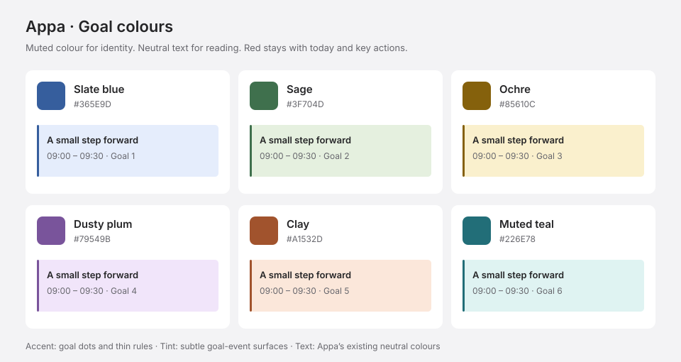

# Appa design system

Last updated: 17 October 2026. The rules below include calendar, event creation and common-action patterns. The Common action patterns section distinguishes the target standard from implementation gaps.

## Reusable interaction and visual rules

Consolidated on 17 October 2026. Reuse these patterns for calendar components and contextual editing cards. The sections below give their component details; [docs/product.md](docs/product.md) records event defaults, repeat behaviour and scheduling rules.

| Pattern | Reusable rule |
| --- | --- |
| Stable control shapes | Keep a control's corner radius consistent across rest, hover, focus and selection. Use the component measurements below rather than applying one radius to every control. Hover changes colour rather than shape. Preserve visible keyboard focus. |
| Distinct calendar states | Today's date uses white text on a red rounded square independently of selection. Selecting a date adds no separate date fill or text colour. In the mini-calendar, selection highlights the corresponding week's date area in grey, excluding the week number. Hover feedback belongs to the individual date. |
| Neutral reference information | Use neutral grey for public-holiday labels and ordinary date colours for holiday dates. All day space shares the calendar's white surface, with soft grey chips for its entries. Keep the established red accents for today, the composer action and the current-time indicator. |
| Readable secondary content | De-emphasise adjacent-month dates through a lighter grey while retaining at least 4.5:1 text contrast on the actual background. Check rest, hover, focus and selected-week surfaces; adjust foreground colour for each surface rather than reducing opacity indiscriminately. |
| Text alignment and compact labels | Align related text to a shared inset rather than centring their containers. Size compact labels to their text and padding. Extend a connected indicator line to meet its label without a gap. |
| Continuous calendar surfaces | Use internal dividers to separate dates. Day and Week omit the border between the time gutter and the first date column, including All day space. Keep the white calendar surface continuous. |
| Contextual editing and draft previews | Use an anchored, nonmodal inline card for quick calendar creation/editing, keeping the calendar visible. Creation shows an unsaved reservation. Changing All day preserves the card and reservation's original location until Save; form resizing preserves position with viewport clamping. Clean drafts dismiss immediately; changed drafts follow the unsaved-change protection rule below. |

### Approved component measurements

These values belong to the named components. Reuse the corresponding pattern without changing unrelated controls.

| Component | Measurement and treatment |
| --- | --- |
| Today's date marker | 4px corner radius, white text on `--accent`; independent of the selected date. |
| Mini-calendar date buttons | 4px corner radius in every state; today's filled marker is 24px square. |
| Mini-calendar selected week | `#e5e5e9` behind the seven date columns, excluding the week-number gutter; individual-date hover uses `#dbdbdf`. |
| Composer action | 32px square, 8px corner radius, white arrow on `--accent`. |
| Day/Week time gutter | 56px wide; hourly times, All day and the Week number share a 16px left text inset. |
| Current-time label | Content width; 3px vertical and 4px horizontal padding; 5px corner radius. Position its container at 12px so the text starts at 16px. Extend the line behind the label to connect its right edge. |
| Week number | `Wk 42` format in the Week date-header gutter; 11px caption text; follows Show week numbers. |
| All day space | White surface; 58px minimum row height; 150px maximum per date cell with internal scrolling. Holiday chips use `--muted` text on `#f1f1f3`. |

## Buttons

Updated on 17 October 2026. [Carbon's button guidelines](https://www.carbondesignsystem.com/building-blocks/core/components/button/guidelines#overview) are a reference for behavior and purpose only. Appa retains its own typography, colours, borders, dimensions and alignment. Explicit user decisions in this document take precedence over the reference.

### Role and hierarchy

- Give each task flow one main action. Use `primary` for confirmation or progression, `secondary` for its cancellation/back alternative, and `supporting` for independent actions. Supporting actions keep Appa's existing outlined appearance. The user-defined Settings roles below take precedence over these general defaults.
- Destructive actions use explicit consequence-based labels and the `danger-action` / `data-action="destructive"` marker. Use Delete for destruction, Remove for detaching preserved objects, Replace calendar for backup replacement, and Clear calendar for clearing the entire workspace. Retain calendar Undo and apply the impact-based safeguards below.
- Planner Back to intention preserves the plan. Continue editing plan returns to it; creating a new AI plan is a separate supporting action while a draft exists. A failed generation retains the previous plan.
- Delete step has a visible label and offers Undo deletion. Undo restores the complete prior plan, including prerequisites; a subsequent plan edit replaces that single removal undo opportunity. Removal recovery lasts for the current planner session, while the draft itself remains persisted.
- Use the shared `IconButton` for icon-only actions. Its accessible name also supplies a hover/focus tooltip. The user explicitly excludes Close buttons and the red composer Plan this goal button from tooltips: the familiar X and composer prompt already explain those actions. Set `showTooltip={false}` for these controls and retain their accessible names. Escape dismisses other tooltips; scroll, resize, blur and activation clear them. Tooltips render within the active dialog when needed to stay in its top layer.
- External actions identify new-tab navigation with a launch icon and accessible text. Check connection describes the actual sign-in status check; busy actions retain their disabled/loading labels.

| Role        | Purpose                                                                   | Appa treatment                                                                                                          |
| ----------- | ------------------------------------------------------------------------- | ----------------------------------------------------------------------------------------------------------------------- |
| Primary     | Main action within the current task or section                            | Dark fill with white content; the composer retains its red accent in a 32px rounded square with 8px corners              |
| Secondary   | Alternative to the main action, or an explicitly assigned Settings action | Existing outlined button                                                                                                |
| Supporting  | Independent or lower-emphasis action                                      | Existing outlined or text action, depending on context                                                                  |
| Destructive | An action that removes or replaces data                                   | Explicit consequence-based label, appropriate emphasis and recovery/confirmation; no Carbon colour or shape is imported |

Secondary and supporting describe different purposes even when their outlined appearance is identical. Destructive intent is separate from emphasis: a confirmation can be a primary destructive action, while Delete step remains a lower-emphasis destructive action.

### Home, planner and task cards

The bottom composer is a floating chat container centred within the calendar workspace. Its input retains the existing compact width (560px maximum, shrinking with viewport space) and 48px minimum height. Clicking or focusing the input keeps it compact for typing. Submitting a non-empty message opens the conversation and sends the message in the same action, expanding the white container upward to 400px total height, including the input, capped by available workspace height. When disconnected, Send stays enabled and shows “Sign in to ChatGPT first” on hover or keyboard focus; clicking it opens sign-in while retaining any message, including when the input is empty. The conversation, header and input share exactly the same outer width. Calendar content stays visible on both sides; do not add a full-width background panel, side panel or backdrop.

Use an 8px radius for expanded chat, a subtle border/shadow, compact Appa header and no Close button. The input stays at its original bottom position; the scrollable conversation appears above it. User bubbles align right; assistant avatar and bubble align left, contained within the same padded width. Use native text, existing typography and the small red send arrow. Escape or outside click collapses chat without deleting the draft or conversation. Opening follows unsaved-change protection for other editors.

Chat uses the existing personal ChatGPT connection and local assistant API: show actual replies, clarification, busy and actionable error states. Review plan opens the existing planner; only explicit approval changes the schedule. Manual planning remains available. Conversation and unsent text survive collapsing/navigation within the current session, but are not included in calendar backups and do not survive reload.

Use one conversation for goal/event planning, calendar questions and replanning; see [Chat assistant behavior](docs/chat-assistant.md). Read-only answers show recorded/completed status and clickable event references, with the searched dates disclosed. Calendar selection includes date/time, group and occurrence scope. Work/non-work is confirmed by the user's checkboxes. Preview new times shows the original and proposed date/time for every selected entry, then Apply changes or Cancel changes. Explain that unselected entries stay in place. Applying commits the complete set with one Undo; stale proposals ask for fresh times and do not apply. Repeating moves are labelled This occurrence only. Preserve short busy/error states and the typed message on failure. New plan/event proposals remain editable through the existing review surfaces. SQLite saves finish before assistant requests, and local changes are briefly locked during Apply.

Place a Calendar section above Active goals in the sidebar and mobile goals panel. Each current calendar item uses a rounded-square visibility checkbox, name and an options button shown on hover, keyboard focus or touch devices. Toggling hides/shows its related personal events in Day, Week, Month, Year and the Day list without removing data or freeing scheduling reservations. The options offer Edit calendar and Delete calendar.

Edit calendar replaces the name in place with an input; do not open a page or editor dialog. The rounded square becomes a colour button opening a small white rounded popover with a Colour caption and six system-colour circles. Use a ring for the selected colour and a visible focus outline; retain native radio keyboard operation. Enter/check saves name and colour; X/Escape cancels with the existing dirty-draft protection. Saving updates all related event surfaces and persists through backups with Undo. Keep the primary Create event button for adding personal entries.

Calendar deletion includes its personal events, completed history and repeating series, preserves goals, explains its scope and offers impact-based confirmation, backup export and Undo. Creating an event after deletion recreates the default Personal tasks group. Existing backups without group settings inherit a visible Personal tasks calendar with Slate blue as its default colour.

| Context                                   | Main action                        | Other actions and behavior                                                                     |
| ----------------------------------------- | ---------------------------------- | ---------------------------------------------------------------------------------------------- |
| Home sidebar                              | + Create event — primary           | Retains its 34px height, 11px label, position and compact shape; dark fill with white content  |
| Create event card                         | Save event                         | Floating inline card beside a dashed draft reservation; no backdrop. Cancel, Close, Escape, outside clicks and navigation protect changed drafts before discarding them. |
| Goal composer                             | Red rounded square Plan this goal  | Opens planning; the nearby prompt explains the action                                          |
| Planner start                             | Create an AI plan                  | Write a plan myself is a supporting text action; sign-in is supporting here                    |
| Return to intention with an existing plan | Continue editing plan              | Create a new AI plan is supporting; Back preserves the draft                                   |
| Plan editor                               | Approve & schedule / Save in Later | Back to intention, Create step and labelled Delete step remain lower-emphasis actions           |
| Task details                              | Mark as complete                   | Edit is the compact outlined alternative; scheduled later steps are clickable rows             |
| Task editor                               | Update                             | Cancel is the compact outlined alternative                                                     |
| Clear-calendar confirmation                        | Clear calendar               | Keep this calendar cancels; the existing calendar Undo remains available                       |
| Backup replacement confirmation           | Replace calendar                   | Cancel retains the existing calendar; the existing import Undo remains available               |

### Settings button roles

| Section           | Primary              | Secondary                    |
| ----------------- | -------------------- | ---------------------------- |
| User              | Sign in with ChatGPT | —                            |
| Calendar settings | —                    | —                            |
| Goal settings     | —                    | —                            |
| Backup            | —                    | Export backup, Import backup |

Settings changes apply and save immediately, as requested on 2026-10-19. All sections omit Done and Save/Cancel buttons. Close Settings with the header X, Escape or the backdrop. The planner retains supporting sign-in; the User section promotes it to primary. Connected-account Sign out and pending-sign-in Check connection retain their existing supporting roles.

### Icon buttons and tooltip exceptions

| Icon-only control                     | Tooltip                                     | Accessible name       |
| ------------------------------------- | ------------------------------------------- | --------------------- |
| Close dialog / Close task details (X) | None — familiar close action                | Required and retained |
| Red rounded square Plan this goal     | None — the composer prompt supplies context | Required and retained |
| Calendar previous/next arrows         | Show on hover and keyboard focus            | Required              |
| Mobile Your goals / Settings icons    | Show on hover and keyboard focus            | Required              |
| Dismiss message icon                  | Show on hover and keyboard focus            | Required              |

Use `IconButton` with `showTooltip={false}` for the two approved exceptions. Removing a tooltip never removes the accessible label or keyboard operation. Delete step uses visible text rather than an icon-only destructive action.

### Labels, states and maintenance

- Name the action and its consequence clearly. Keep Check connection, Clear calendar and Replace calendar rather than ambiguous status or reset wording.
- Preserve native button behavior, keyboard focus and disabled states. Actions that are processing retain their explanatory loading labels and prevent repeated submission.
- Keep links for external navigation, including Continue to ChatGPT and How it works; indicate a new tab with the launch icon and accessible text.
- Keep the established footprints: standard actions are at least 43px high with 13px semibold labels; task-card actions are 34px high with 13px semibold labels. The home sidebar primary action is the explicit 34px / 11px medium exception. Changing a role must not unintentionally import larger padding or typography.
- Before changing shared buttons, check User, Calendar settings, Goal settings, Backup, planner, task read/edit states and narrow widths. Verify tooltip exceptions, draft preservation and removal recovery alongside appearance.

## Common action patterns

Updated on 17 October 2026 using [Carbon's Common actions](https://www.carbondesignsystem.com/building-blocks/core/patterns/common-actions) as a behavior reference. Keep Appa's existing visual system and explicit Settings button roles. These interaction rules incorporate the corrections identified in the [source-based review](docs/common-actions-review-2026-10-17.md). They are implemented in the browser application; live interaction verification and desktop packaging remain separate checks. Where older component descriptions conflict, this section governs action semantics, data-loss protection and recovery.

### Vocabulary and classification

| Pattern | Appa rule and application |
| --- | --- |
| Create | Make a new object: Create event, Create step, Create an AI plan or Write a plan myself. Use Create step in planner and goal editing when aligning labels with this vocabulary. |
| Add | Insert an existing object into a collection or active context. Activating a saved Later goal adds it to the calendar. Do not imply creation when reusing an existing object. |
| Edit | Enter an explicit editing state. Preserve saved values until Save/Update succeeds; Cancel returns to the previous state after resolving unsaved changes. |
| Save / Update / Apply | Commit the current draft. Retain Save event, Save goal, Update, Save in Later and Approve & schedule where their scope is clear. Settings apply automatically. Show success after the action succeeds and retain input on failure. |
| Cancel | Stop the current operation. Use a secondary action. Cancellation must not silently discard changed values; use the protection rule below. |
| Close | Dismiss a card, dialog or message with the existing X and accessible name. Escape and outside clicks follow the same dirty-state rule for explicit drafts. Preserve the approved no-tooltip exception for Close. Settings closes through X, Escape or its backdrop; valid changes are already applied. |
| Clear | Empty a field, selection or explicitly named data scope. A field-clear control uses X beside the value with an accessible name such as Clear event name. Clear calendar is a destructive bulk action, not an ordinary field clear. |
| Copy | Produce an identical copy, with Copied feedback after success. No dedicated clipboard-copy or duplication action currently exists. Export a copy remains an export operation. |
| Delete | Destroy an object. Use Delete event, Delete this occurrence, Delete step or Delete goal. Keep trash/danger treatment and safeguards proportional to impact. Undo does not change deletion into removal. |
| Remove | Detach an object from a collection while preserving the object elsewhere. Use a lower-emphasis button or subtract icon. Do not use Remove for deleting saved events, draft steps or an entire calendar. |
| Reset | Restore the last saved/applied values. Do not use Reset as the label for clearing the workspace, importing a backup or Undo. No dedicated Reset control is currently required. |
| Next / Back | Move through a sequence without losing valid draft data. Context-specific labels such as Continue planning and Back to intention are appropriate. Calendar arrows navigate dates and are not wizard progression. |
| Refresh | Update information from its source. Check connection retains a checking state; automatic calendar/account refresh preserves the user's context. Today navigates to a date and is not a refresh action. |
| Errors | Explain the failed action and a practical next step beside the relevant form or in the calendar banner. Retain entered values and offer retry where useful. Translate technical exceptions into user-facing recovery guidance. |
| Feedback / Undo | Announce successful changes and provide the relevant recovery action. Keep feedback consistent with the action and scope. The current calendar Undo is one level and does not survive reload; never imply permanent recovery. |

### Protect unsaved changes

- A draft is dirty when its current values differ from the initial or last saved values. Opening a form or focusing a field alone does not make it dirty.
- Clean drafts close immediately. For changed event, task, goal or settings drafts, retain the draft or ask Discard changes? with Keep editing and Discard changes. Keep editing preserves all entered values; Discard changes returns to saved data.
- Apply the same rule to Cancel, X, Escape, outside clicks and navigation that would abandon the draft. Keep the existing floating card nonmodal during ordinary editing. Return focus to the relevant trigger or editing control after dismissal or cancellation.
- Calendar and Goal settings apply valid changes immediately. Invalid availability input stays local for correction; the last valid settings remain active. Settings has no unsaved overall draft or Done/Save/Cancel buttons.
- Planner drafts already persist. Back to intention and closing/reopening the planner preserve the plan; continue this behavior. Draft-step Undo restores prerequisites as well as the step.

### Destructive scope and safeguards

| Impact | Required treatment |
| --- | --- |
| Low: trivial to restore or recreate | Immediate deletion with clear feedback and available Undo is appropriate; do not add routine confirmation dialogs. Draft-step deletion belongs here. |
| Moderate: meaningful saved content, multiple objects or limited recovery | Explain what will be deleted and request confirmation with an explicit action label. Identify included steps/history or affected occurrences. |
| High: substantial history, expensive recreation or cascading loss | Explain the affected scope, offer a backup route where applicable and require typing the resource name in the confirmation. Judge actual content and consequences rather than assigning every deletion to this tier. |

- Delete goal includes its pending and completed steps, recurrence and saved choices. Disclose that scope and choose safeguards based on the goal's content. Make the action available for both Active and Later goals without requiring activation. Completed history remains read-only during editing but may be included in explicitly confirmed goal deletion.
- Delete this occurrence affects one repeating event occurrence. Changing Repeat affects this and following events; explain that scope beside Repeat before saving. Do not imply a series-wide deletion option exists unless implemented.
- Clear calendar must accurately disclose that goals, events, repeating series, history and choices are cleared. If the action is specifically labelled Remove example goals, it must remove only examples and preserve personal work.
- Replace calendar describes backup replacement, including affected data and available Undo. Show relevant goal, task and repeating-series counts. Apply stronger protection for high-impact replacement rather than assuming the backup makes current data expendable.
- Successful deletion closes the relevant editor/details and returns to the containing calendar/list, with success feedback and Undo where supported. Failure retains the object and editing context and explains how to continue.
- Keep one primary action per task. A destructive confirmation may be primary; Delete goal and Delete step inside an editor stay separate from Save and lower in emphasis. Preserve compact typography and allow footer actions to fit narrow screens.

### Additional application patterns

Appa also uses calendar navigation and date drill-down; selection and configuration; task completion and prerequisite restrictions; import/export; authentication and external navigation; loading and empty states; tooltips; history/prerequisite disclosures; resizable Day panels; and automatic catch-up with a recovery summary. These complement the action vocabulary above. Use the existing component rules for their appearance and [product behavior](docs/product.md) for scheduling and persistence constraints.

### Toast notifications

Toast notifications show a labelled X dismiss control at the right edge after any Undo action. Each new notification dismisses automatically after five seconds; a later action starts a fresh five-second lifetime. Manual dismissal and timeout hide only the toast and do not mutate calendar data. Keep the existing status announcement, compact dark surface and keyboard-operable controls. Persistent error and recovery banners are separate from transient toasts.

### Implementation status and acceptance

Implemented: shared dirty-draft protection; persistent Save/Cancel for changed settings across sections; Delete event/Delete this occurrence, Delete step and Create step labels; accurate Clear calendar scope; goal-deletion confirmations and backup export; Later-goal deletion; and actionable network/file error messages. Empty goals delete immediately; goals with saved steps require confirmation; goals with at least 30 steps or 10 completed steps require typing the saved goal name. Calendar clearing/replacement requires typing Appa when the current workspace contains personal content, completed work or at least 30 tasks. Calendar Undo remains one level until the next committed change or reload.

Verify affected flows at desktop and narrow widths: create/edit/save/cancel; X/Escape/outside-click/navigation with clean and dirty drafts; settings section switching; Active and Later goal deletion; occurrence scope; failed deletion; success feedback; and Undo before another change and after reload. Check keyboard focus and accessible error/status announcements in the running product. The source-based review did not verify these live interactions or screenshots.

## Typography

Approved on 15 October 2026 from the user's event-details reference. Audit improvements were applied across the active calendar, task cards, settings and dialogs, with verification completed on 16 October 2026. This document describes the implemented shared styles in [src/styles.css](src/styles.css).

### Foundation and ratio

- Family: **Inter**, bundled locally, with `Arial, sans-serif` fallbacks.
- Weights: regular **400**, medium **500**, semibold **600**.
- Body size: **13px**. Content title: **17px**.
- Title-to-body ratio: approximately **1.3:1** (`13 × 1.3 = 16.9`, rounded to 17px).
- Supporting sizes: **14 / 12 / 11 / 10px**. The narrow calendar header uses 16px; the Appa brand uses 19px.

The 1.3 ratio describes a content title relative to its body text. It is not a multiplier between every adjacent size. Preserve the 17/13 card hierarchy when making future changes.

### Shared size and weight tokens

These CSS custom properties are defined on `:root` and consumed by the active interface components.

| Token                  | Value | Role                                                      |
| ---------------------- | ----: | --------------------------------------------------------- |
| `--text-title`         |  17px | Content, calendar and dialog titles                       |
| `--text-title-compact` |  16px | Calendar title at widths up to 1050px                     |
| `--text-section`       |  14px | Internal section headings and calendar context            |
| `--text-body`          |  13px | Body values, fields and actions                           |
| `--text-label`         |  12px | Secondary labels, date numbers and full-value summaries   |
| `--text-caption`       |  11px | Captions, timeline titles and desktop Month task names    |
| `--text-dense`         |  10px | Calendar annotations and narrow Month task names          |
| `--text-brand`         |  19px | Appa identity only                                        |
| `--weight-regular`     |   400 | Body and supporting text                                  |
| `--weight-medium`      |   500 | Content titles, navigation and date numbers               |
| `--weight-semibold`    |   600 | Section headings, dialog titles, actions and event titles |

### Content presets

Line heights are unitless; tracking is in CSS pixels. Use the size, weight and rhythm together as a role.

| Style             | Size | Weight | Line height | Tracking | Use                                              |
| ----------------- | ---: | -----: | ----------: | -------: | ------------------------------------------------ |
| Content title     | 17px |    500 |         1.3 |   -0.2px | Task title and its edit field                    |
| Page/dialog title | 17px |    600 |         1.3 |   -0.4px | Main calendar and dialog headings                |
| Section heading   | 14px |    600 |         1.4 |   -0.3px | Settings panel legends and Day task-list heading |
| Callout heading   | 14px |    500 |         1.4 |        0 | Account connection heading                       |
| Body value        | 13px |    400 |         1.4 |        0 | Short values and task details                    |
| Body paragraph    | 13px |    400 |         1.6 |        0 | Explanations and multi-line copy                 |
| Secondary label   | 12px |    400 |         1.4 |        0 | Goal, duration and selected-value summaries      |
| Caption           | 11px |    400 |         1.5 |        0 | Later-step metadata and help                     |
| Dense annotation  | 10px |    400 |         1.4 |        0 | Calendar metadata and week numbers               |

The Settings dialog title is 17px; the panel inside it uses the 14px section-heading tier. Date/time values in a task card use the compact 1.4 rhythm; explanatory paragraphs retain 1.6.

### Controls and fields

| Style                    | Size | Weight | Line height | Tracking |
| ------------------------ | ---: | -----: | ----------: | -------: |
| Primary/secondary action | 13px |    600 |         1.4 |        0 |
| Text action              | 13px |    500 |         1.4 |        0 |
| Field value              | 13px |    400 |         1.4 |        0 |
| Title field              | 17px |    500 |         1.3 |   -0.2px |
| Field hint               | 11px |    400 |         1.5 |        0 |

Entering edit mode keeps the same title/body hierarchy as the read view. Standard form values and footer actions remain 13px on narrow screens. Keep click targets independent of text size: task-card actions are 34px high and its Close target is 24px square.

### Calendar presets and responsive rules

Only today receives a red date marker, using a rounded square with 4px corners and white text, independently of selection. Selecting a date does not change its fill or text colour in Day, Week, Month or the mini-calendar. In the left mini-calendar, selecting a date highlights its whole week's date area in the established subtle grey, excluding the week-number gutter. Mini-calendar date buttons retain the same 4px corner radius at rest, on hover and on keyboard focus; hover and focus change only other dates' backgrounds, without a shape change. Week rows follow the configured first weekday, while the chosen date remains available to assistive technology through its pressed state.

| Role                                    | Size / weight | Rhythm and behaviour                                                |
| --------------------------------------- | ------------- | ------------------------------------------------------------------- |
| Main title                              | 17px / 600    | 1.3 line height; 16px at widths up to 1050px                        |
| Calendar context                        | 14px / 400    | 1.4 line height; -0.25px tracking; 13px at widths up to 1050px      |
| Day/Week/Month date number              | 12px / 500    | Tabular numbers; today uses white on the red accent                 |
| Mini-calendar date                      | 11px / 500    | Compact sidebar exception                                           |
| Calendar view navigation                | 11px / 500    | Compact labels; selected state also changes surface and text colour |
| Week/Day event title                    | 11px / 600    | 1.25 line height inside short timeline events                       |
| Desktop Month event title               | 11px / 600    | 1.4 line height                                                     |
| Month event title at widths up to 600px | 10px / 600    | 1.4 line height; full label wraps                                   |
| Event metadata                          | 10px / 400    | Compact calendar information                                        |
| Month section heading                   | 12px / 500    | 1.4 line height                                                     |

At widths up to 1050px, Month labels wrap instead of using ellipsis, and their secondary times are hidden. At widths up to 600px, the 10px label style and reduced horizontal padding preserve whole words in ordinary short task names. Month rows can grow to fit content. Long unbroken strings may break rather than overflow neighbouring days. Do not reintroduce 8px task names or shrink ordinary form values to solve limited width.

Times, durations, date numbers and week numbers use `font-variant-numeric: tabular-nums`. This applies to numeric information, while task titles retain their normal letter shapes.

### Text colours and contrast

| Token            | Value     | Use                                               | Sample contrast                        |
| ---------------- | --------- | ------------------------------------------------- | -------------------------------------- |
| `--ink`          | `#242426` | Primary interface text                            | Strong contrast on white               |
| `--muted`        | `#66666c` | Informative secondary text, hints and annotations | 5.70:1 on white; 5.06:1 on `#f1f1f3`   |
| `--mini-outside-date` | `#6e6e74` | Mini-calendar dates from adjacent months | 4.57:1 on the `#f3f3f5` rail |
| `--accent`       | `#c82240` | Today's date marker and composer action            | White text on the accent exceeds 4.5:1 |
| `--current-time` | `#c5362b` | Current-time label, line and dot                  | White text on the fill is 5.33:1       |

Use at least 4.5:1 contrast for ordinary informative text on its actual background. Differentiate supporting content through size, weight and spacing alongside its darker secondary colour. Completed timeline tasks retain readable text and a strike-through. Recheck foreground/background pairs when adding surfaces or changing colours. These sampled pairs are not a claim of full accessibility conformance.

Mini-calendar dates from the previous and next months use the lighter `--mini-outside-date` colour. On the selected week's grey background, override it with `--muted` (4.54:1); on hover/focus, use `#5e5e64` (at least 4.56:1, including the hover brightness filter). Keep today's white-on-red marker. Holiday dates follow the ordinary date colours. Scope this treatment to the mini-calendar.

### Goal colour palette

Edit goal includes a Goal colour fieldset with six labelled native radio options, a swatch and a visible selected state. Wrap the options on narrow screens and retain keyboard focus and radio-key navigation. Colour changes are draft edits: Save goal applies them to that goal's dots and tasks; Cancel protects changed drafts. Changing only colour preserves scheduling, supports Undo and persists through backups.

Created and refined on 17 October 2026: strengthen blue, green, gold, purple, orange and teal separation so goal identities remain recognisable in the calendar. Keep red reserved for existing product accents. Use six distinct, moderately saturated hues with clearly differentiated pale surfaces to distinguish goals while retaining Appa's quiet white/grey surfaces and red navigation/action accents. Implemented with scoped goal tokens: tinted calendar task backgrounds, coloured dots and thin edge rules; the floating details card stays white with a matching edge. Legacy saved keys remain valid: indigo maps to Sage, teal to Muted teal, amber to Ochre and rose to Dusty plum. New slate and clay keys complete the six-colour cycle. The first assigned goal uses Sage to match the approved mockup.



| Colour | Accent | Soft surface | Accent contrast on white |
| --- | --- | --- | --- |
| Slate blue | `#365E9D` | `#E5EDFC` | 6.47:1 |
| Sage | `#3F704D` | `#E5F0DF` | 5.78:1 |
| Ochre | `#85610C` | `#FAF0CD` | 5.66:1 |
| Dusty plum | `#79549B` | `#F1E5FA` | 5.91:1 |
| Clay | `#A1532D` | `#FBE7DA` | 5.54:1 |
| Muted teal | `#226E78` | `#DFF3F2` | 5.88:1 |

Use accents for goal dots and thin event-edge rules, and the matching pale surface for goal events where colour is useful. Retain `--ink` for titles and `--muted` for secondary text; both exceed 4.5:1 on every listed soft surface. Avoid large saturated fills. The accent ratios above are calculated from the specified hex values, not a claim of full accessibility verification.

Colours identify goals rather than assigning categories such as work, health or personal. Assign Sage, Slate blue, Ochre, Dusty plum, Clay and Muted teal in sequence, then cycle when necessary. Keep the goal name visible; colour alone must not communicate identity, completion, selection or errors. Shared slots whose alternatives belong to one goal use that goal colour. Mixed-goal slots stay neutral until a choice is made, then use the chosen goal colour. Personal events use their calendar group colour, independently of goal colours. Selection uses the existing neutral border/focus treatment independently of goal colour. Today, the composer, current time and destructive intent retain their established roles; a clay goal is never an error signal.

When implementing, introduce semantic goal tokens rather than changing the legacy `--indigo` or other globally reused variables: those also style unrelated controls. Preserve existing saved colour keys and backup compatibility, explicitly map them to the new palette, and remove any legacy patterned goal treatment only within the goal-colour migration. Do not recolour general buttons or public holidays.

### Narrow Settings fields

At widths up to 600px, timezone and holiday-calendar fields show a 12px wrapping summary of the complete selected value. Explicit region selections show the full country/region label below the region field. Standard select values remain 13px. The left menu is retained.

These summaries repeat the native selected option and are hidden from assistive technology to avoid duplicating its value. The native controls retain their labels, full option text and relevant help descriptions.

### All-day events

The All day row uses the calendar's white surface. Its label aligns with the hourly labels at a 16px left inset in the time gutter. Week's number moves from the month-title context into the date header's left gutter, shown compactly as Wk 42 in the 11px caption role and hidden when Show week numbers is off. Keep Day and Month week-number placement unchanged.

Day and Week timelines have no left border between the time gutter and the first date column, including the All day row. Retain vertical dividers between adjacent date columns.

Standalone event creation and editing include a labelled Repeat select with Does not repeat (default), Every day, Every week, Every fortnight, Every month and Every year. Place it after the date/time fields and retain it when All day hides times. Use the existing native select, 13px field typography and compact card padding. Event details show the chosen repeat label. The editor explains that event changes affect this occurrence, while changing Repeat updates this and following events; its deletion action says Delete this occurrence for series occurrences and Delete event for a standalone event.

Event creation and standalone-event editing use a labelled All day switch with a monochrome track and an accessible checked state. When enabled, hide the time fields and show the date and the hint Moves to the All day row when saved. Keep the creation card and draft reservation at their original location until Save; toggling does not re-anchor the card to another row. Form resizing retains its position, with viewport clamping when necessary. Keep the existing floating inline card and its 17px title, 13px fields and 34px actions; preserve typed times when toggling the creation draft back to timed mode. Event creation accepts a blank name and saves New event by default; use New event as its placeholder.

Week has a 58px minimum All day row immediately beneath its date headers. Day uses the same row beneath its date strip, spanning the selected day's timeline column. Align the row to the existing time gutter and day columns and keep it visible while the timeline scrolls. Rows may grow for stacked entries, with a 150px maximum per day cell and internal scrolling. User events use compact grey chips; the unsaved draft retains its dashed border. Public holidays use neutral `--muted` text on `#f1f1f3` chips in this row rather than underneath the weekday text. Month holiday labels also use `--muted`; holidays do not add red date highlighting in the mini-calendar. Use real configured holiday data; the approved mockup's holiday label was illustrative.

All-day events show no clock range or duration in their chips or details. Month and the Day task list place them before timed events. Their date-based meaning is independent of the timed grid and planned-minute count.

### Year view

Year follows Month in the existing segmented view control and uses the same continuous white calendar panel. Scroll vertically through earlier and later years, with a 14px semibold year heading and a subtle horizontal divider separating each year's twelve months. The main title follows the year at the viewport's centre, with Year view as secondary context. Load years as needed and preserve the visible position as the render window moves. Arrange each year's twelve compact month grids in four columns, reducing to three, two and one as the calendar panel narrows. Month headings use the 13px semibold body tier; dates use the 11px medium caption tier; weekday initials and optional ISO week numbers use the 10px dense tier. Keep all month rows aligned with six weeks of space.

Month headings open Month; dates open Day. Today keeps the shared 24px red marker with 4px corners. Other dates have no selected fill; hover changes colour with a stable 4px radius and keyboard focus stays visible. Leave adjacent-month positions blank. A small neutral dot indicates scheduled work, including all-day and repeating events; holiday labels stay neutral and appear on hover. Keep space beneath the grid for the floating composer.

### Optional goal availability

Goal settings begins with Set available time, using a labelled monochrome checkbox and 13px medium text. Explain that it limits goal scheduling to certain hours. When checked, show the existing Available from / Until inputs and pending-step explanation. When unchecked, hide the time inputs and explain that goals may be scheduled at any time of day while existing tasks stay in place. Valid changes apply and save immediately; remembered hours persist when toggling or switching sections. Incomplete or invalid time inputs remain editable locally while the last valid settings stay active, with an inline explanation. The Until field accepts 00:00 as midnight at the end of the day. Use the header X, Escape or backdrop to close, native keyboard/focus behavior, a programmatically associated explanation, and the same narrow-screen field layout as Calendar settings.

### Active-goal editing

Goal details use a secondary Edit goal action. The editor uses Save goal as its primary action, Cancel as secondary and Delete goal as a separate lower-emphasis destructive action. Goal deletion explains its affected steps and history and follows the safeguards below. Delete step is a labelled destructive action with Undo deletion until the next draft edit. Keep completed work read-only, show validation errors beside the editor, and explain when recurrence changes replace upcoming sessions. Use the shared title, body and control typography; fields and actions must fit narrow screens without horizontal scrolling.

### Task-card footprint

The card keeps its approved **17 / 13 / 12 / 11px** hierarchy. Its maximum width is 360px, capped at viewport width minus 32px. Padding is 18px, or 16px on narrow screens; actions remain 34px high. Preserve the existing white surface, monochrome actions and section order.

The existing task-card aliases now reference the shared size tokens:

```css
--task-card-title-size: var(--text-title);
--task-card-body-size: var(--text-body);
--task-card-caption-size: var(--text-caption);
```

### Rhythm tokens and maintenance

- Line height: `--leading-title:1.3`, `--leading-compact:1.4`, `--leading-caption:1.5`, `--leading-body:1.6`.
- Tracking: `--tracking-title:-0.2px`, `--tracking-page:-0.4px`, `--tracking-section:-0.3px`, `--tracking-context:-0.25px`.
- The short timeline-event line height of 1.25 and current-time-label line height of 1.2 are explicit exceptions that fit those compact geometries.
- The red current-time label fits its HH:mm text with 4px horizontal padding. Place the container at 12px so its text aligns with the hourly labels' 16px left inset. Extend the lighter current-time line into the gutter behind the opaque label so it connects directly to the label's right edge; the label does not stretch across the gutter.

Prefer a shared role over a new literal font size. Scope new variants to the component that needs them. Older layout rules may retain explicit values until their consumers are reviewed; avoid broad replacements that change unrelated layouts.

Keep text native, preserve browser zoom support and allow longer copy to wrap. Before changing this standard, check task read/edit states, Day/Week/Month, Settings and the planner at desktop and narrow widths. Include 200% text resizing and user text-spacing overrides when making accessibility claims; native Electron display-scaling verification remains a separate check.


### Empty calendar slot activation

Double-click empty timed space in Day/Week, empty All day space or an empty Month cell to create an event. Single pointer clicks do not open event creation. Keyboard activation with Enter or Space still creates an event; timed keyboard activation defaults to 09:00. Date navigation and opening existing events remain single-click actions. Explicit Create event buttons remain single-click actions. The same activation rules apply to past dates.
