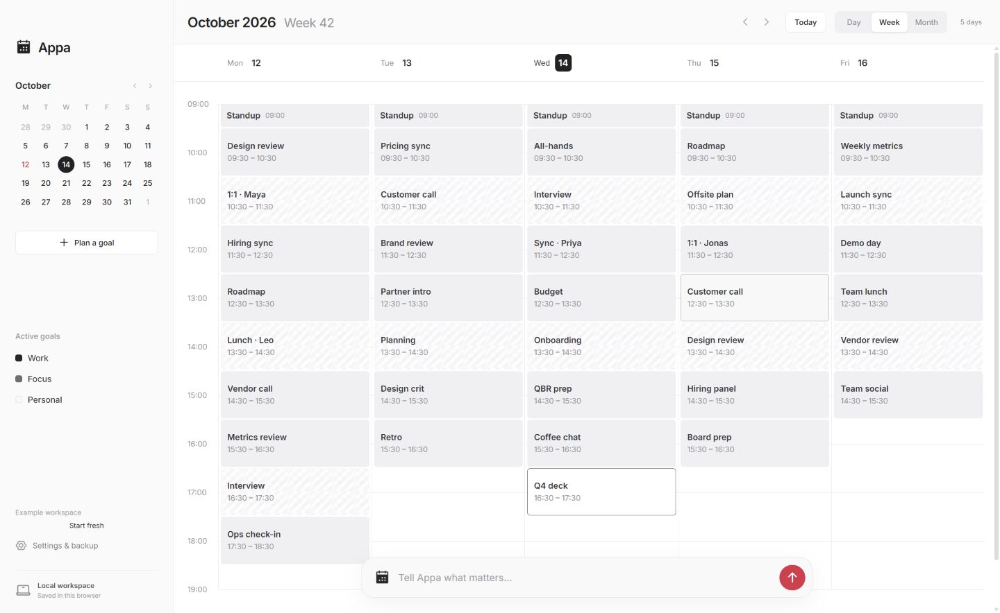

# Appa

A personal planning assistant that turns intentions into small, achievable steps. Appa is a local, open-source Windows desktop app. Use your own eligible ChatGPT account for AI planning, or write a plan yourself and work offline.

**Early release · Windows x64 · MIT license**



The screenshot shows the current source with example tasks. New desktop installations start empty. Installers on GitHub Releases are published separately from source updates.

## Get the desktop app

Download the Windows preview installer from [GitHub Releases](https://github.com/ellenWang918/appa/releases). End users do not need Node.js when using the installer.

Run the Windows setup file to install Appa for your Windows account. Setup adds **Appa** shortcuts to the desktop and Start menu. Double-click the desktop shortcut, or search for Appa in Start, to open the standalone app. No terminal or development server is needed. To remove the app, use **Windows Settings → Apps → Installed apps → Appa → Uninstall**.

Appa was previously named AI Goal Calendar. Version 0.1.0 retains that name in its published installer; builds from the current source use Appa. The repository is now `ellenWang918/appa`, and existing local goals, drafts and settings are preserved.

The first release is unsigned and has no automatic updater. Windows may show an unrecognized-publisher warning; code signing is planned for a later release. Download only from this repository's Releases page.

## Start with one goal

1. Open Appa. A new installation starts with an empty calendar and your computer's timezone.
2. Available hours start at 18:00–21:00. You can change them anytime in **Settings → Goal settings**. Scheduling uses these hours without a separate daily budget.
3. Describe your intention in the bottom input and submit it, or choose **Plan a goal**. Sign in once in **Settings → User**, then select **Create an AI plan** in the planner, or choose **Write a plan myself** without signing in.
4. Review and edit the proposed steps. Choose **Add to active goals** or **Save in Later**, then approve.
5. Use **Today** to return to the current date, then select a task for its details. When a slot offers alternatives, choose one. Mark work complete only when you finish it.

Open a saved goal in **Later** and choose **Make this goal active** whenever you are ready. More than two goals can be active; scheduling fits within your available hours.

Open an active goal and choose **Edit goal** to change its name, pending steps, durations, prerequisites or recurrence. Completed work stays read-only. Saved edits support Undo in the current session.

## Bring your own ChatGPT account

Open **Settings → User** and choose **Sign in with ChatGPT → Continue to ChatGPT**. The app opens your system browser. Complete sign-in and consent there, return to the app, and choose **I've signed in**. Available models come from your account.

ChatGPT plan usage depends on account eligibility and shares your existing plan limits. This app does not provide an AI subscription or promise support for every provider. The initial integration supports eligible ChatGPT Plus and Pro accounts through OpenAI's documented open-source/local-app flow. See the [official overview](https://developers.openai.com/siwc/token-sharing-open-source) and [preview limitations](https://developers.openai.com/siwc/token-sharing-open-source/preview-limitations).

The desktop app securely remembers your sign-in using Windows-protected encryption and renews it automatically after reopening. Use **Settings → User → Sign out** to remove the saved session. OpenAI may require sign-in again if access is revoked or the renewable session expires. Tokens are available only to the main process; they are excluded from calendar backups and browser storage. Account registration metadata and a stable installation ID are saved separately. The browser development preview keeps credentials in memory only. Your goal text and clarification are sent directly to OpenAI only when you request AI planning. Manual planning and the calendar work offline.

Live account consent and real inference require an eligible user's authorization. Automated tests cover protocol and application boundaries; they do not replace live account verification.

## Calendar behavior

- Day, Week and Month views use the same local calendar. Navigate dates with the left month picker or the header arrows; **Today** returns to the current date.
- Scroll Month view up or down to browse earlier and later months. The heading and mini calendar follow the visible month; **Today** jumps back to this month.
- Week always shows Monday through Sunday, with a full-day timeline from 00:00 to 24:00.
- Day and Week open at the current time. **Today** returns the timeline there after you scroll; it stays under your control as the clock advances.
- Day places an hourly timeline on the left and its task list on the right, with independent scrolling. On narrow screens, the task list sits below the timeline.
- Day's header shows the surrounding Monday–Sunday week. Select any date to update both panels.
- Drag the divider beside Day's task list to resize it. Your width is remembered; double-click the divider to reset it. Keyboard users can focus it and use Left/Right arrows.
- Describe an intention in the floating input to open the planner. Tasks are scheduled only after approval.
- Select a task to open its details, choose an activity in a shared slot, or mark it complete. The selected task keeps its outline after the details close.
- Task details float beside the event, keeping the calendar usable. Choose **Edit** to change its name, date and start/end times in the same card, then **Update** to save or **Cancel** to discard the edit. Duration follows the time range; scheduling checks and Undo still apply.
- Tasks aim at 5–25 minutes; genuine prerequisites preserve order. Week rows expand for short steps so consecutive five-minute tasks remain readable.
- Shared slots reserve the longest alternative until you select one, then use that activity's duration. Selection alone does not complete work.
- Completing a shared choice skips competing recurring occurrences for that slot. Unchosen project work stays pending, and future recurring sessions keep their normal cadence.
- Returning after missed days moves unfinished project work in dependency order, consolidates overdue repeats, and shows a recovery summary with Review and Undo.
- Undo covers the latest committed change in the current page session. Restarting or reloading begins a new undo session.

The interface uses a light grey calendar, a left month navigator and a floating goal input. In the browser preview, narrow screens show compact goal/settings controls; Day and Month fit the screen while Week can scroll horizontally.

## Your data

Goals, drafts, settings and progress are stored in the desktop app's local profile. There is no maintainer-operated AI server, analytics or cloud synchronization. Local data is not encrypted by this app. Keep private backups through **Settings → Backup → Export backup**.

**Settings → Calendar settings** contains timezone, interface language (English for now), week numbers, the first day of the week, and public holidays. Holidays default from the timezone; select a country and region to override them, or choose None. Holiday rules are bundled locally and work offline. Local show days and one-off changes may not be included; holidays are reference labels and do not block goal scheduling.

To move from the browser prototype, export there and import the file in the desktop app. Your browser and desktop calendars are separate; importing is an explicit choice. See [desktop storage and recovery](docs/desktop.md) and [security and privacy](SECURITY.md).

## Build from source

Requirements: Windows x64 and Node.js 22 or newer.

```sh
npm ci
npm run build
npm test
npm run desktop
```

Build the installer:

```sh
npm run desktop:dist
```

The installer is written to `release/`. `npm run desktop:pack` creates an unpacked app. GitHub Actions runs checks on changes and can build installer artifacts on a version tag or manual workflow dispatch. The workflow does not automatically publish a release.

For interface development, `npm run dev -- --host 127.0.0.1 --port 4173 --strictPort` opens a separate browser preview. The production desktop app uses bundled assets and a private local server; no hosted website is required. The static hosting template files are retained for compatibility but are not the desktop runtime.

Application code uses strict TypeScript: React components in `.tsx`, scheduling and services in `.ts`, and Electron's sandboxed preload in `.cts`. Shared domain and API types are defined in `src/types.ts`. Run `npm run typecheck` to check the interface and runtime; production builds require this check to pass. Runtime code compiles into `dist/runtime/`, while Vite builds the interface into `dist/client/`. Electron and the automated tests execute the compiled runtime without a TypeScript loader.

## Code structure

| Location | Responsibility |
| --- | --- |
| `src/App.tsx`, `src/CalendarViews.tsx` | React calendar views, date navigation and goal input |
| `src/Dialogs.tsx`, `src/ui.tsx` | Planning, settings, goal details and shared controls |
| `src/calendar.ts`, `src/types.ts` | Scheduling, recurrence, recovery, backup validation and shared TypeScript contracts |
| `src/styles.css` | Calendar layout, colours and responsive styles |
| `server/chatgpt.ts` | Local ChatGPT sign-in and AI planning service |
| `desktop/` | Electron startup, private local server, preload and external-link policy |
| `tests/` | Scheduling, backup, desktop security and hosting regression checks |

## Contribute

See [DESIGN.md](DESIGN.md) for the approved typography scale and reusable interface text styles.

See [CONTRIBUTING.md](CONTRIBUTING.md). Report reproducible bugs through [Issues](https://github.com/ellenWang918/appa/issues). Read [SECURITY.md](SECURITY.md) before reporting vulnerabilities. Never upload tokens, authorization URLs, account registration files, personal backups or private goal text.

## License

[MIT](LICENSE), copyright 2026 ZiWang. Third-party dependencies retain their own licenses; see [notices](THIRD_PARTY_NOTICES.md) and the `third-party/` directory.
