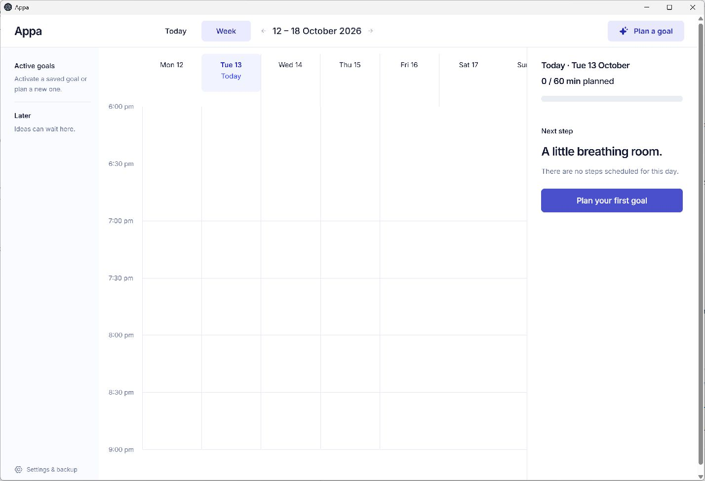

# Appa

A personal planning assistant that turns intentions into small, achievable steps. Appa is a local, open-source Windows desktop app. Use your own eligible ChatGPT account for AI planning, or write a plan yourself and work offline.

**Early release · Windows x64 · MIT license**



## Get the desktop app

Download the Windows preview installer from [GitHub Releases](https://github.com/ellenWang918/ai-goal-calendar/releases). End users do not need Node.js when using the installer.

Appa was previously named AI Goal Calendar. Version 0.1.0 retains that name in its published installer; builds from the current source use Appa. The repository URL stays the same, and existing local goals, drafts and settings are preserved.

The first release is unsigned and has no automatic updater. Windows may show an unrecognized-publisher warning; code signing is planned for a later release. Download only from this repository's Releases page.

## Start with one goal

1. Open Appa. A new installation starts with an empty calendar and your computer's timezone.
2. Open **Settings & backup** to choose your daily time budget and available hours. The initial budget is 60 minutes within 18:00–21:00.
3. Choose **Plan a goal**. Describe your intention, connect your own ChatGPT account, and select **Create an AI plan**. You can also choose **Write a plan myself** without signing in.
4. Review and edit the proposed steps. Choose **Add to active goals** or **Save in Later**, then approve.
5. Use **Today** to find the next action. When a slot offers alternatives, choose one. Mark work complete only when you finish it.

Open a saved goal in **Later** and choose **Make this goal active** whenever you are ready. More than two goals can be active; scheduling still respects your daily budget.

## Bring your own ChatGPT account

Choose **Sign in with ChatGPT → Continue to ChatGPT**. The app opens your system browser. Complete sign-in and consent there, return to the app, and choose **I've signed in**. Available models come from your account.

ChatGPT plan usage depends on account eligibility and shares your existing plan limits. This app does not provide an AI subscription or promise support for every provider. The initial integration supports eligible ChatGPT Plus and Pro accounts through OpenAI's documented open-source/local-app flow. See the [official overview](https://developers.openai.com/siwc/token-sharing-open-source) and [preview limitations](https://developers.openai.com/siwc/token-sharing-open-source/preview-limitations).

OAuth access and refresh tokens stay in the local main process's memory. **Reconnect after quitting and reopening the app.** Account registration metadata and a stable installation ID are saved locally, without tokens. Your goal text and clarification are sent directly to OpenAI only when you request AI planning. Manual planning and the calendar work offline.

Live account consent and real inference require an eligible user's authorization. Automated tests cover protocol and application boundaries; they do not replace live account verification.

## Calendar behavior

- Today and Week views use the same local calendar.
- Tasks aim at 5–25 minutes; genuine prerequisites preserve order.
- Shared slots reserve the longest alternative until you select one, then use that activity's duration. Selection alone does not complete work.
- Completing a shared choice skips competing recurring occurrences for that slot. Unchosen project work stays pending, and future recurring sessions keep their normal cadence.
- Returning after missed days moves unfinished project work in dependency order, consolidates overdue repeats, and shows a recovery summary with Review and Undo.
- Undo covers the latest committed change in the current page session. Restarting or reloading begins a new undo session.

## Your data

Goals, drafts, settings and progress are stored in the desktop app's local profile. There is no maintainer-operated AI server, analytics or cloud synchronization. Local data is not encrypted by this app. Keep private backups through **Settings & backup → Export backup**.

To move from the browser prototype, export there and import the file in the desktop app. Your browser and desktop calendars are separate; importing is an explicit choice. See [desktop storage and recovery](docs/desktop.md) and [security and privacy](SECURITY.md).

## Build from source

Requirements: Windows x64 and Node.js 22 or newer.

```sh
npm ci
npm test
npm run desktop
```

Build the installer:

```sh
npm run desktop:dist
```

The installer is written to `release/`. `npm run desktop:pack` creates an unpacked app. GitHub Actions runs checks on changes and can build installer artifacts on a version tag or manual workflow dispatch. The workflow does not automatically publish a release.

For interface development, `npm run dev -- --host 127.0.0.1 --port 4173 --strictPort` opens a separate browser preview. The production desktop app uses bundled assets and a private local server; no hosted website is required. The static hosting template files are retained for compatibility but are not the desktop runtime.

## Contribute

See [CONTRIBUTING.md](CONTRIBUTING.md). Report reproducible bugs through [Issues](https://github.com/ellenWang918/ai-goal-calendar/issues). Read [SECURITY.md](SECURITY.md) before reporting vulnerabilities. Never upload tokens, authorization URLs, account registration files, personal backups or private goal text.

## License

[MIT](LICENSE), copyright 2026 ZiWang. Third-party dependencies retain their own licenses; see [notices](THIRD_PARTY_NOTICES.md) and the `third-party/` directory.
