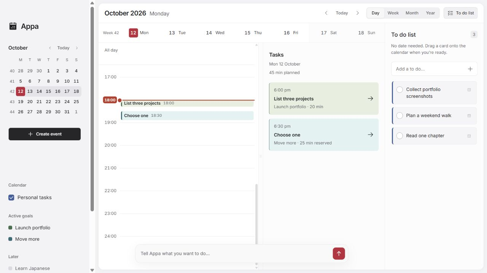
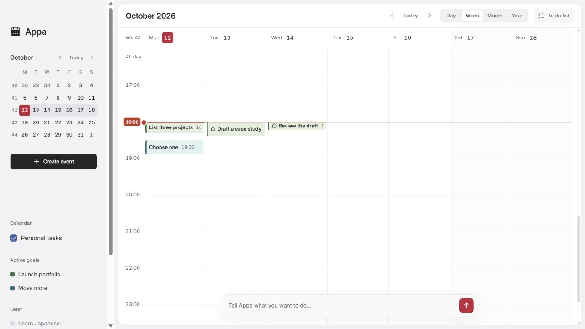

# Appa

Appa is an open-source Windows calendar and personal planning assistant. Keep appointments, goal steps and unscheduled to dos in one workspace. Drag work onto your calendar, adjust its time and duration, and check it off when you finish.

Connect your own eligible ChatGPT account to break goals into manageable steps, ask questions about your calendar, rearrange events and manage your To do list. Review proposed changes before applying them. The calendar, To do list and manual planning work offline without an AI account.

**Early release · Windows x64 · MIT license**



Day view with the To do list open in Appa 0.1.6. Screenshots use an isolated example workspace with sample tasks. New desktop installations start empty. Installers on GitHub Releases are published separately from source updates.

<details>
<summary>See the Week view</summary>



The To do list can be hidden from the header to give the calendar more room.

</details>

## Features

- **Plan at any scale.** Switch between Day, Week, Month and Year, browse dates from the mini calendar, or return to Today. Day view pairs the timeline with a daily task list.
- **Move and resize cards.** Drag pending timed cards to another slot in Day or Week. The target outline matches the card's colour. Drag a card's top or bottom edge to change its duration in five-minute steps.
- **Capture tasks without a date.** Add items to the To do list, check them off, or drag them onto the calendar when you're ready. Open or hide the list with its header button.
- **Turn goals into next steps.** Create a plan manually or with AI, review its steps and prerequisites, then activate it or keep it in Later. Scheduling follows your available hours and existing reservations.
- **Ask Appa for help.** Plan goals and events, ask calendar-history questions such as “When was my last haircut?”, rearrange scheduled work, or add and manage to dos through chat. AI features use your own eligible ChatGPT account.
- **Review changes and recover missed work.** Inspect AI proposals before applying them. Undo the latest saved change, and review, undo or dismiss the catch-up summary after missed days.
- **Keep everyday details together.** Create timed, all-day and repeating events. Choose your timezone, first weekday, week numbers and public holidays. Settings apply as you change them.
- **Capture appointments as you type.** Enter an event name, date and time in the compact composer and press Enter. Recognised details become editable tags; date/time tags support arrow-key adjustment and normal text editing after deletion. Direct event entry works without an AI account.
- **Organise calendar groups consistently.** Personal tasks and Active goals share visibility controls, inline name/colour editing and options. Hidden groups still reserve their scheduled time; longer goal details expose additional steps and history with Show more.
- **Keep your calendar on your computer.** Events, goals, to dos, settings and progress save to local SQLite storage. Export and import JSON backups; everyday planning works offline.

## Get the desktop app

Download the Windows preview installer from [GitHub Releases](https://github.com/ellenWang918/appa/releases). End users do not need Node.js when using the installer.

Run the Windows setup file to install Appa for your Windows account. Setup adds **Appa** shortcuts to the desktop and Start menu. Double-click the desktop shortcut, or search for Appa in Start, to open the standalone app. No terminal or development server is needed. To remove the app, use **Windows Settings → Apps → Installed apps → Appa → Uninstall**.

Appa was previously named AI Goal Calendar. Version 0.1.0 retains that name in its published installer; builds from the current source use Appa. The repository is now `ellenWang918/appa`, and existing local goals, drafts and settings are preserved.

The first release is unsigned and has no automatic updater. Windows may show an unrecognized-publisher warning; code signing is planned for a later release. Download only from this repository's Releases page.

## Start with one goal

1. Open Appa. A new installation starts with an empty calendar and your computer's timezone.
2. In **Settings → Goal settings**, use **Set available time** to limit scheduling to certain hours, initially 18:00–21:00. Turn it off to allow any time of day. Existing tasks stay in place, and your saved hours are remembered. There is no separate daily budget.
3. Describe your intention in the bottom input and submit it, or choose **Plan a goal**. Sign in once in **Settings → User**, then select **Create an AI plan** in the planner, or choose **Write a plan myself** without signing in.
4. Review and edit the proposed steps. Choose **Add to active goals** or **Save in Later**, then approve.
5. Use **Today** to return to the current date, then select a task for its details. When a slot offers alternatives, choose one. Mark work complete only when you finish it.

Open a saved goal in **Later** and choose **Make this goal active** whenever you are ready. More than two goals can be active; scheduling follows your goal settings.

Open an active goal and choose **Edit goal** to change its name, pending steps, durations, prerequisites or recurrence. Completed work stays read-only. Saved edits support Undo in the current session.

## Bring your own ChatGPT account

Open **Settings → User** and choose **Sign in with ChatGPT → Continue to ChatGPT**. The app opens your system browser. Complete sign-in and consent there, return to the app, and choose **I've signed in**. Available models come from your account.

ChatGPT plan usage depends on account eligibility and shares your existing plan limits. This app does not provide an AI subscription or promise support for every provider. The initial integration supports eligible ChatGPT Plus and Pro accounts through OpenAI's documented open-source/local-app flow. See the [official overview](https://developers.openai.com/siwc/token-sharing-open-source) and [preview limitations](https://developers.openai.com/siwc/token-sharing-open-source/preview-limitations).

The desktop app securely remembers your sign-in using Windows-protected encryption and renews it automatically after reopening. Use **Settings → User → Sign out** to remove the saved session. OpenAI may require sign-in again if access is revoked or the renewable session expires. Tokens are available only to the main process; they are excluded from calendar backups and browser storage. Account registration metadata and a stable installation ID are saved separately. The browser development preview keeps credentials in memory only. When you use AI chat, your message, recent conversation and necessary date/timezone/availability context are sent directly to OpenAI. Calendar searches and move validation run locally; records shown in earlier chat replies can be included in a follow-up conversation. Manual planning and the calendar work offline.

Live account consent and real inference require an eligible user's authorization. Automated tests cover protocol and application boundaries; they do not replace live account verification.

## Calendar behavior

- Chat can add, list, rename, complete, reopen, remove and schedule items in the To do list. Try “Add buy milk to my to do list” or “Schedule call Mum tomorrow at 10am”. Existing items are matched locally; select matches and review changes before applying. Batch changes support one Undo.

- **To do list** on the right accepts tasks without a date or time. Add a title and press Enter, or turn off **Set date and time** in Create event. Use the leading check button to complete or reopen an item. Drag a pending card into Day/Week to schedule thirty minutes, then resize it as needed; drop onto a Month date or All day row for an all-day event. The card's Schedule button opens the date/time editor. Scheduling moves the item out of the list and supports Undo. The list saves locally and is included in backups.

- The **To do list** button beside the view switcher opens or hides the right panel without losing your list or draft.
- Drag pending timed cards in Day or Week to change their date and time. A target outline in the card's colour previews the new slot. Hover or focus a card to reveal its top and bottom resize handles; drag either edge to change the time range. Moves and resizing snap to five minutes, check scheduling conflicts and support Undo. Repeating-event changes affect that occurrence only.

- Day, Week, Month and Year views use the same local calendar. Navigate dates with the left month picker or the header arrows; **Today** returns to the current date.
- Scroll Month view up or down to browse earlier and later months. The heading and mini calendar follow the visible month; **Today** jumps back to this month.
- Scroll Year view in either direction to browse earlier and later years. Each year shows all twelve months, and the heading follows the visible year. Select a month heading to open Month or a date to open Day.
- Use **Create event** or double-click an empty calendar slot to add an event without a goal. Events can be timed or all day and can repeat daily, weekly, fortnightly, monthly or yearly. Public holidays appear in the All day row. Event changes support Undo, and fixed events reserve space when goals are scheduled.
- Week always shows Monday through Sunday, with a full-day timeline from 00:00 to 24:00.
- Day and Week open at the current time. **Today** returns the timeline there after you scroll; it stays under your control as the clock advances.
- Day places an hourly timeline on the left and its task list on the right, with independent scrolling. On narrow screens, the task list sits below the timeline.
- Day's header shows the surrounding Monday–Sunday week. Select any date to update both panels.
- Drag the divider beside Day's task list to resize it. Your width is remembered; double-click the divider to reset it. Keyboard users can focus it and use Left/Right arrows.
- Use the floating chat to plan a goal/event, ask about calendar history, or rearrange upcoming entries. Review new work before saving; select entries and preview new times before applying moves. One Undo restores the complete move set.
- Select a task to open its details, choose an activity in a shared slot, or mark it complete. The selected task keeps its outline after the details close.
- Task details float beside the event, keeping the calendar usable. Choose **Edit** to change its name, date and start/end times in the same card, then **Update** to save or **Cancel** to discard the edit. Duration follows the time range; scheduling checks and Undo still apply.
- Tasks aim at 5–25 minutes; genuine prerequisites preserve order. Week rows expand for short steps so consecutive five-minute tasks remain readable.
- Shared slots reserve the longest alternative until you select one, then use that activity's duration. Selection alone does not complete work.
- Completing a shared choice skips competing recurring occurrences for that slot. Unchosen project work stays pending, and future recurring sessions keep their normal cadence.
- Returning after missed days moves unfinished project work in dependency order, consolidates overdue repeats, and shows a recovery summary with Review, Undo and a dismiss button.
- Undo covers the latest committed change in the current page session. Restarting or reloading begins a new undo session.

The interface uses a white calendar with subtle weekend shading, a left month navigator and a compact chat input. Clicking the chat input keeps it collapsed for typing; sending opens the conversation. When disconnected, Send stays enabled and asks you to sign in to ChatGPT first. In the browser preview, narrow screens show compact goal/settings controls; Day and Month fit the screen while Week can scroll horizontally.

## Your data

Goals, events, drafts, settings and progress are stored in a local SQLite database, `calendar.sqlite`, in the desktop app's profile (`%APPDATA%/AI Goal Calendar`). Existing calendars migrate on first opening, with the original browser copy retained. The development preview uses a separate `.local/calendar.sqlite`. There is no maintainer-operated AI server, analytics or cloud synchronization. Local data is not encrypted by this app. Keep private backups through **Settings → Backup → Export backup**.

**Settings → Calendar settings** contains timezone, interface language (English for now), week numbers, the first day of the week, and public holidays. Holidays default from the timezone; select a country and region to override them, or choose None. Holiday rules are bundled locally and work offline. Local show days and one-off changes may not be included; holidays are reference labels and do not block goal scheduling.

Settings apply and save immediately. There is no Save or Done button; close Settings with the X, Escape or an outside click. Invalid availability changes show an explanation and keep the last valid settings active.

To move from the browser prototype, export there and import the file in the desktop app. Your browser and desktop calendars are separate; importing is an explicit choice. See [desktop storage and recovery](docs/desktop.md) and [security and privacy](SECURITY.md).

## Build from source

Requirements: Windows x64 and Node.js 22.13 or newer (with built-in SQLite).

```sh
npm ci
npm run build
npm test
npm run desktop
```

Build the installer:

```sh
npm run desktop:dist
```

The installer is written to `release/`. `npm run desktop:pack` creates an unpacked app. GitHub Actions runs checks on changes and can build installer artifacts on a version tag or manual workflow dispatch. The workflow does not automatically publish a release.

For interface development, `npm run dev -- --host 127.0.0.1 --port 4173 --strictPort` opens a separate browser preview. The production desktop app uses bundled assets and a private local server; no hosted website is required. The static hosting template files are retained for compatibility but are not the desktop runtime.

Application code uses strict TypeScript: React components in `.tsx`, scheduling and services in `.ts`, and Electron's sandboxed preload in `.cts`. Shared domain and API types are defined in `src/types.ts`. Run `npm run typecheck` to check the interface and runtime; production builds require this check to pass. Runtime code compiles into `dist/runtime/`, while Vite builds the interface into `dist/client/`. Electron and the automated tests execute the compiled runtime without a TypeScript loader.

## Code structure

| Location | Responsibility |
| --- | --- |
| `src/App.tsx`, `src/useCalendarWorkspace.ts`, `src/useCalendarNavigation.ts` | Workspace composition, authoritative calendar changes, save recovery and date/view navigation |
| `src/CalendarViews.tsx`, `src/CalendarTimeline.tsx`, `src/YearCalendar.tsx` | Calendar views with shared timeline and indexed year summaries |
| `src/Dialogs.tsx`, `src/ui.tsx`, `src/GoalNavigation.tsx`, `src/ColorPicker.tsx` | Planning/settings/goal details and shared controls/navigation |
| `src/TodoPanel.tsx`, `src/timelineDrag.ts`, `src/useTimelineResize.ts` | Undated tasks, calendar drag-and-drop and duration resizing |
| `src/calendar.ts`, `src/calendarQueries.ts`, `src/calendarDates.ts`, `src/types.ts` | Scheduling, recurrence, indexed queries, date helpers, validation and shared contracts |
| `src/goalPalette.ts`, `src/timeRange.ts` | Shared colour definitions and time-range conversion |
| `src/styles.css` | Calendar layout, colours and responsive styles |
| `server/chatgpt.ts`, `server/calendar-assistant.ts`, `server/todo-assistant.ts` | Local ChatGPT sign-in, structured assistant responses, history retrieval, reviewed replanning and To do list actions |
| `server/calendar-store.ts`, `src/calendarStorage.ts`, `src/calendarPersistence.ts` | SQLite snapshots and incremental projections, migration, coalesced saves and safe retry |
| `desktop/` | Electron startup, private local server, preload and external-link policy |
| `tests/` | Domain, persistence, desktop security, synthetic renderer journeys and hosting regression checks |

## Contribute

See [DESIGN.md](DESIGN.md) for the approved typography scale and reusable interface text styles.

See [CONTRIBUTING.md](CONTRIBUTING.md). Report reproducible bugs through [Issues](https://github.com/ellenWang918/appa/issues). Read [SECURITY.md](SECURITY.md) before reporting vulnerabilities. Never upload tokens, authorization URLs, account registration files, personal backups or private goal text.

## License

[MIT](LICENSE), copyright 2026 ZiWang. Third-party dependencies retain their own licenses; see [notices](THIRD_PARTY_NOTICES.md) and the `third-party/` directory.
